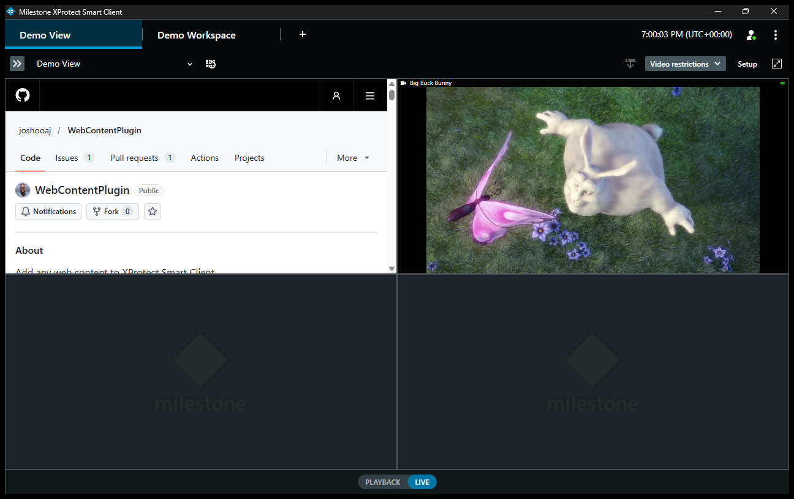
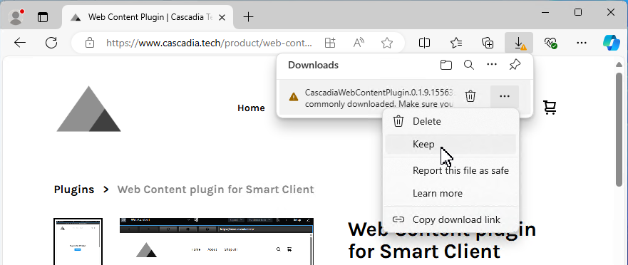
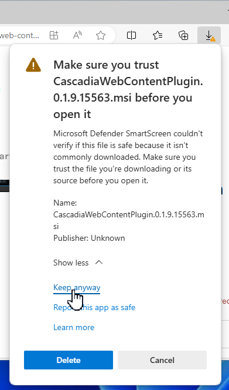
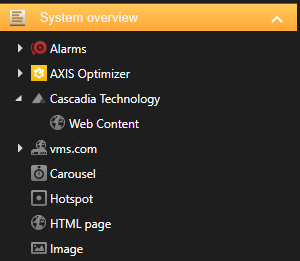
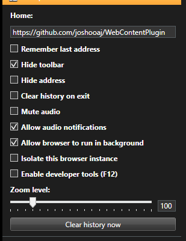

# Web Content Plugin for XProtect Smart Client

Add rich web content to the Smart Client with a browser component that is
always up to date and widely compatible with the modern web, popular IoT
platforms, and more.

The Web Content plugin uses the Microsoft Edge WebView2 runtime which means it
will always be kept up to date without the need to upgrade the plugin. And
because it is a Microsoft Edge browser, it will work with whatever content you
need it for.



## Features

- **Evergreen** browser based on Microsoft Edge WebView2 Runtime. Browser stays up to date even if the plugin does not.
- **Runs in Background** when enabled. Your browser session isn't lost if you switch views and come back.
- **Isolate browser sessions** for improved security. Each browser instance can use its own "profile" reducing the risk
  of exposing data between instances.
- **Remember the last address** instead of always navigating to the configured home address on startup.
- **Automatically clear history** when the client is closed if you don't want to leave sensitive browser history on disk.
- **Hide the toolbar** or even just the address field to minimize misuse of the browser or simply regain some of that precious screen real estate.
- **Easily mute unexpected audio** from a browser in a previous view that is no longer displayed. If a background browser
    should start playing sound, you'll see a notification with the name of the web page and a button to mute that browser instance.

## Browser data per XProtect user

The Web Content plugin stores its WebView2 browser profile in
`%APPDATA%\SmartClient.WebContentData`, **keyed to the XProtect login identity** you used to sign
into Smart Client, not merely to the Windows account. Different XProtect users therefore start with
**separate, fresh** browser profiles — they do not inherit each other's browsing history, cookies or
saved credentials on the same machine.

**Important — the Windows account is the security boundary.** WebView2/Chromium encrypts protected
browsing data (cookies and saved passwords) with Windows DPAPI, which is tied to the Windows logon.
Two different XProtect accounts on the *same* Windows account are separated but not
*cryptographically* isolated from each other. To keep two XProtect identities fully private, log
each into Smart Client under a **distinct Windows account**.

### Deliberately sharing a browser profile

If multiple operators intentionally need to share a single WebContent profile (for example a shared
control-room operator), they must log into Smart Client as the **same XProtect login identity** on
the **same Windows machine account**. Using different XProtect identities will give each a separate
profile even on a shared Windows account.

See `docs/adr/0001-browser-profile-per-xprotect-user.md` for the full decision and the security
analysis.

## Getting started

### Install the plugin

Download and run the [CascadiaWebContentPlugin](https://download.cascadia.tech/software/CascadiaWebContentPlugin.msi) installer.

The installer is not currently signed and your browser will warn you about the file is potentially unsafe. You can
validate the file hash against the [SHA256 hash](https://download.cascadia.tech/software/CascadiaWebContentPlugin.msi.sha256.txt).

Click **Keep**, and if your browser asks again, click **Keep anyway**. The installation experience will improve when I
get a code signing certificate setup.

The installer is very simple and has no options. Acknowledge the license, and then it will install the Microsoft Edge
WebView2 Runtime if necessary, and place the plugin files in `C:\Program Files\VideoOS\MIPPlugins\CascadiaWebContentPlugin\`.





### Add Web Content to a view

1. Open a new Smart Client instance (plugins are only discovered during startup) and login.
2. Click the **Setup** button at the top right.
3. Select an existing view, or create a new view.
4. Locate **Cascadia Technology > Web Content** in the **System Overview** side panel, and drag it into the view.



### Configuration

1. With the new Web View selected, scroll to the bottom of the side panel where you'll find the properties.
2. Update the Home address, and any other options as needed.
3. Click the **Setup** button again to exit setup mode.



## License

The Web Content Plugin is free to use with all features. No license,
activation, or time limit is required. It is distributed under the
[MIT License](./LICENSE).

## Software Build of Materials

You will find a software build of materials, also known as an SBOM (S-bomb), in the `_manifest` subdirectory of the
plugin installation path at `C:\Program Files\VideoOS\MIPPlugins\CascadiaWebContentPlugin\_manifest\spdx_2.2\`. In this
folder you will find the SBOM file `manifest.spdx.json` in SPDX:2.2 format, along with `manifest.spdx.json.sha256` which
is a SHA256 hash of the SBOM file.

These files are generated using Microsoft's [sbom-tool](https://github.com/microsoft/sbom-tool) and the same tool can be
used to validate your own software installation. To do so, you would install `sbom-tool` per Microsoft's documentation
and then run the following command.

```plaintext
dotnet sbom-tool validate -b C:\Program Files\VideoOS\MIPPlugins\CascadiaWebContentPlugin\ -o .sbom-validation.txt -mi SPDX:2.2
```

Or, if the `sbom-tool` command is installed globally on `PATH` you can drop the leading `dotnet` cli command name.

```plaintext
sbom-tool validate -b C:\Program Files\VideoOS\MIPPlugins\CascadiaWebContentPlugin\ -o .sbom-validation.txt -mi SPDX:2.2
```
