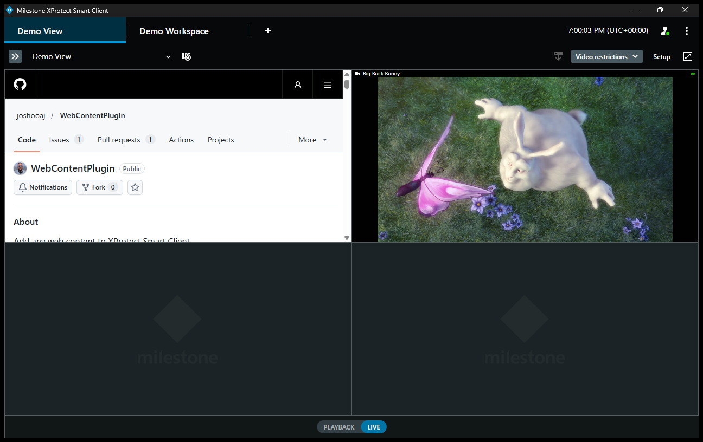
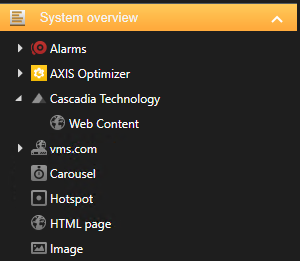
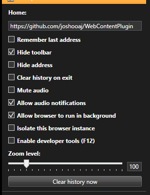
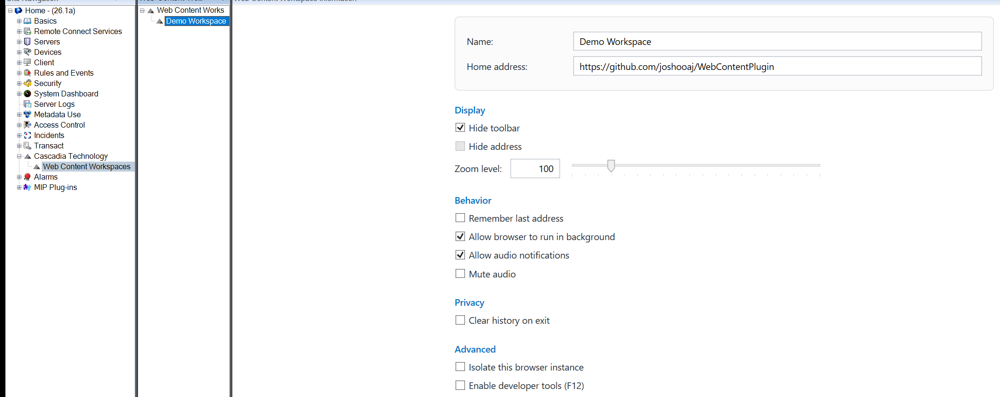
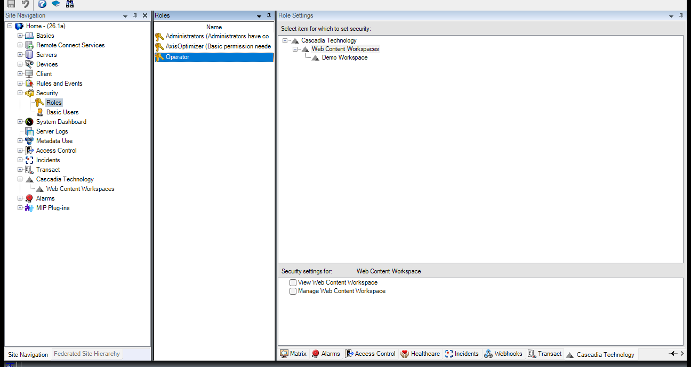

# Web Content Plugin for XProtect Smart Client

Add rich web content to the Smart Client with a browser component that is
always up to date and widely compatible with the modern web, popular IoT
platforms, and more.

The Web Content plugin uses the Microsoft Edge WebView2 runtime which means it
will always be kept up to date without the need to upgrade the plugin. And
because it is a Microsoft Edge browser, it will work with whatever content you
need it for.



## Features

- **Evergreen** browser based on Microsoft Edge WebView2 Runtime. Browser stays up to date even if the plugin does not.
- **Runs in Background** when enabled. Your browser session isn't lost if you switch views and come back.
- **Isolate browser sessions** for improved security. Each browser instance can use its own "profile" reducing the risk
  of exposing data between instances.
- **Remember the last address** instead of always navigating to the configured home address on startup.
- **Automatically clear history** when the client is closed if you don't want to leave sensitive browser history on disk.
- **Hide the toolbar** or even just the address field to minimize misuse of the browser or simply regain some of that precious screen real estate.
- **Easily mute unexpected audio** from a browser in a previous view that is no longer displayed. If a background browser
    should start playing sound, you'll see a notification with the name of the web page and a button to mute that browser instance.

## Browser data per XProtect user

The Web Content plugin stores its WebView2 browser profile in
`%APPDATA%\SmartClient.WebContentData`, **keyed to the XProtect login identity** you used to sign
into Smart Client, not merely to the Windows account. Different XProtect users therefore start with
**separate, fresh** browser profiles. They do not inherit each other's browsing history, cookies or
saved credentials on the same machine.

**Important: the Windows account is the security boundary.** WebView2/Chromium encrypts protected
browsing data (cookies and saved passwords) with Windows DPAPI, which is tied to the Windows logon.
Two different XProtect accounts on the *same* Windows account are separated but not
*cryptographically* isolated from each other. To keep two XProtect identities fully private, log
each into Smart Client under a **distinct Windows account**.

### Deliberately sharing a browser profile

If multiple operators intentionally need to share a single WebContent profile (for example a shared
control-room operator), they must log into Smart Client as the **same XProtect login identity** on
the **same Windows machine account**. Using different XProtect identities will give each a separate
profile even on a shared Windows account.

See `docs/adr/0001-browser-profile-per-xprotect-user.md` for the full decision and the security
analysis.

## Getting started

### Install the plugin

Download the installer from the [latest release](https://github.com/joshooaj/WebContentPlugin/releases/latest). Run the
file named `CascadiaWebContentPlugin.<version>.msi`.

The installer is not currently signed, so your browser will warn you that the file is potentially unsafe. The release
also carries a `CascadiaWebContentPlugin.<version>.msi.sha256.txt` file that you can use to validate the installer hash.

Click **Keep**, and if your browser asks again, click **Keep anyway**. The installation experience will improve when I
get a code signing certificate setup.

The installer is very simple and has no options. Acknowledge the license, and then it will install the Microsoft Edge
WebView2 Runtime if necessary, and place the plugin files in `C:\Program Files\VideoOS\MIPPlugins\CascadiaWebContentPlugin\`.

### HTTPS targets: deployment certificate authority (one-time setup)

A workspace proxy allowlist may include `https://` targets (optionally flagged
`accept-untrusted` to tolerate a device's self-signed certificate — the flag is per target, never global).
To make those pages render without browser certificate errors, the plugin uses one long-lived certificate
authority per deployment (see `docs/adr/0003-event-server-mints-loopback-leaf-certs.md`):

1. **Create the CA once on the Event Server machine, elevated.** The Event Server service runs as a
   restricted built-in account (`NT AUTHORITY\NETWORK SERVICE` on current Milestone installs) that cannot
   create the CA itself. Run this once from an elevated Windows PowerShell 5.1 session on the Event Server
   machine, after the plugin is deployed there:

   ```powershell
   powershell -ExecutionPolicy Bypass -File scripts/provision-event-server-authority.ps1
   ```

   It creates the CA certificate named `XProtect WebContent Plugin Loopback Proxy` in the LocalMachine
   Personal store, grants the service account read access to the private key so leaf minting works at
   runtime, and exports the certificate to `C:/Users/Public/WebContent-Proxy-Authority.cer`. The private
   key never leaves that machine.
2. **Each Smart Client machine trusts the CA once, elevated.** Copy the exported
   `WebContent-Proxy-Authority.cer` from the Event Server machine's `C:/Users/Public` folder, then on every
   Smart Client machine run:

   ```powershell
   Import-Certificate -FilePath C:\Users\Public\WebContent-Proxy-Authority.cer -CertStoreLocation Cert:\LocalMachine\Root
   ```

   Until that import is done, proxied HTTPS pages load but show a browser certificate error — the plugin
   never bypasses certificate validation on its own, and its log names this exact import step.

To remove the plugin completely, also delete the CA: from `LocalMachine\My` on the Event Server machine
(`Remove-Item Cert:\LocalMachine\My\<thumbprint>`) and from `LocalMachine\Root` on each Smart Client machine.

### Add Web Content to a view

1. Open a new Smart Client instance (plugins are only discovered during startup) and login.
2. Click the **Setup** button at the top right.
3. Select an existing view, or create a new view.
4. Locate **Cascadia Technology > Web Content** in the **System Overview** side panel, and drag it into the view.



### Configuration

1. With the new Web View selected, scroll to the bottom of the side panel where you'll find the properties.
2. Update the Home address, and any other options as needed.
3. Click the **Setup** button again to exit setup mode.



## Workspace administration (Management Client)

The plugin also integrates with the XProtect Management Client. Under **Cascadia Technology**, a
**Web Content Workspaces** node lets administrators centrally define workspaces: their home address,
display options, behavior (background running, audio notifications, history clearing), privacy and
advanced options such as session isolation and developer tools.



### Per-role security

Each workspace is a securable item. On the **Cascadia Technology** tab of a role's security settings,
select a workspace and grant or revoke the granular claims for that role, such as viewing and managing
the web content workspace.



## Proxied web access (route workspace traffic through the VMS server)

Some devices (cameras, intercoms, vendor portals) serve their web pages on a network segment the
operator's computer cannot reach. The **workspace proxy** fixes this: for a proxied workspace the
browser's web traffic is routed away from the operator machine and out of the VMS server's network
instead. The Smart Client fronts the browser with a machine-local forwarding proxy, relays every
request over classic MIP messaging, and the VMS-side plugin component performs the actual fetch.
The operator's computer never contacts the device, and a proxied workspace never silently falls
back to a direct connection.

### What the admin toggles, and where

On the workspace's details page in the **Management Client** under
**Cascadia Technology > Web Content Workspaces**:

1. Tick **Route web traffic through the VMS server proxy** in the **Proxy** section.
2. List the allowed origins, one per line, in **Proxy targets:** — for example
   `http://10.0.0.5:8080` or `https://cam1.example.com:8443 accept-untrusted` (the
   untrusted-certificate override is per target, never global; see the certificate authority
   section above before using `https://` targets).
3. Save. Invalid target lines are refused at save time. A proxied workspace with no valid targets
   stays proxied and refuses everything — the allowlist is never bypassed by direct access.

The toggle takes effect when the workspace tab is (re)opened in Smart Client; the Smart Client
properties page shows the effective proxy state for the workspace.

### The server side is the XProtect EVENT SERVER

The component that performs the fetches runs **inside the XProtect Event Server process — not the
Management Server**. The plugin drop (the MSI, or the build output) must be installed on the
machine running the Event Server as well as on every Smart Client machine. The plugin definition
loads in the `Service` environment, and the Event Server only loads MIP plugins at **service
start**, so a deployment includes a service restart. Use the release MSI on that machine, or run
the documented script from any admin workstation:

```powershell
.\scripts\deploy-event-server-plugin.ps1 -ComputerName <event-server> -Credential <VMS admin account>
```

The script stops the Event Server service and waits for it to stop (the dll is locked while it
runs), copies the drop into `C:\Program Files\VideoOS\MIPPlugins\CascadiaWebContentPlugin`,
verifies every copied file by **SHA-256 hash against the source** (timestamps prove nothing — the
copy preserves them), and restarts the service. Two follow-ups matter after any Event Server
plugin deployment:

- **Restart every Smart Client that was connected before the restart.** The Event Server restart
  disposes each client's messaging channel; without a Smart Client restart every proxied page
  fails with the proxy's "server proxy component is not available" error page (and the log shows
  `Call to TransmitMessage after call to Dispose?`).
- Confirm the fetcher loaded by checking the Event Server's MIP log for
  `Proxy fetcher ready (concurrency=3, request id=WebContent.Proxy.FetchRequest)` — or use the
  Management Client workspace page's **Test proxy fetch** row for an end-to-end check.

### Versions, logs, and failure pages

- The relay rides classic MIP message communication (Event Server message service, default port
  22333). Event Server plugins have been able to register message filters from `Init()` since
  **XProtect 2019 R3** (earlier releases silently failed that registration), so proxied workspaces
  require XProtect 2019 R3 or later. Verified against **XProtect 2024 R2** in the lab where this
  document's deployment records were made.
- Logs for the proxy path: Smart Client plugin activity lands in
  `%ProgramData%\Milestone\XProtect Smart Client\MIPLog.txt` (rolling `MIPLogs\MIPLog.N.txt`);
  the Event Server writes its MIP log to `%ProgramData%\Milestone\XProtect Event Server\logs\MIP.log`
  with rolled archives under `logs\MIPLogs\` (the Event Server tray icon's "Show MIP logs" opens
  them); Management Client diagnostics (including the Test proxy fetch
  harness) go to `Logs\MIP.log` under its ProgramData folder.
- When a proxied page fails, the **browser itself shows an explicit proxy error page** naming the
  failing side — never a silent direct load and never an endless spinner:
  - **403** — the target origin is not in the workspace allowlist (names the origin).
  - **503** — the VMS server proxy component is absent, unreachable, or not answering (deploy
    check above; Smart Client restart needed after an Event Server restart).
  - **502** — the VMS server reached the messaging layer but could not reach the target, or the
    response exceeded the proxy response size cap.
  - **504** — the VMS server fetched the target but the target timed out.

## License

The Web Content Plugin is free to use with all features. No license,
activation, or time limit is required. It is distributed under the
[MIT License](./LICENSE).

## Software Build of Materials

You will find a software build of materials, also known as an SBOM (S-bomb), in the `_manifest` subdirectory of the
plugin installation path at `C:\Program Files\VideoOS\MIPPlugins\CascadiaWebContentPlugin\_manifest\spdx_2.2\`. In this
folder you will find the SBOM file `manifest.spdx.json` in SPDX:2.2 format, along with `manifest.spdx.json.sha256` which
is a SHA256 hash of the SBOM file.

These files are generated using Microsoft's [sbom-tool](https://github.com/microsoft/sbom-tool) and the same tool can be
used to validate your own software installation. To do so, you would install `sbom-tool` per Microsoft's documentation
and then run the following command.

```plaintext
dotnet sbom-tool validate -b C:\Program Files\VideoOS\MIPPlugins\CascadiaWebContentPlugin\ -o .sbom-validation.txt -mi SPDX:2.2
```

Or, if the `sbom-tool` command is installed globally on `PATH` you can drop the leading `dotnet` cli command name.

```plaintext
sbom-tool validate -b C:\Program Files\VideoOS\MIPPlugins\CascadiaWebContentPlugin\ -o .sbom-validation.txt -mi SPDX:2.2
```
